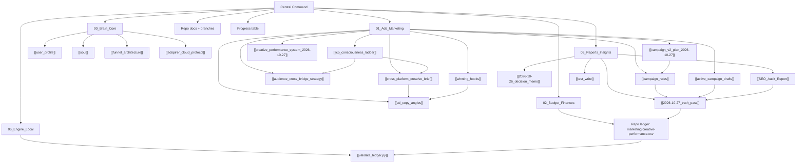

# 🧠 Doctors of Soul — Central Command & Neural Map

> **Decision Lead:** [[user_profile|Prashant Jaiswal]]
> **Domain:** [doctorsofsoul.co.in](https://doctorsofsoul.co.in)
> **Core Philosophy:** [[soul|Advaita, Nervous System Regulation & Conscious Agency]]
> **Last full sync:** 2026-10-28 (repo `origin/main` `82658b2`, campaign docs and every note below re-checked)

**Read in this order:** [[2026-10-27_truth_pass]] (what is actually true) → [[campaign_v2_plan_2026-10-27]] (what is prepared) → the progress table below.

---

## 📊 Progress — verified against repo and live site, 2026-10-27

**Rubric:** % of the work needed to run a paid funnel **safely** that is **done and verified**. These are estimates, not measurements; the "basis" column is the evidence.

| # | Area | % | Basis (verified evidence) | What is still missing |
|---|---|---|---|---|
| 1 | Website & funnel pages | **90%** | `/hi`, `/en`, book pages, checkout, thank-you, upgrade, meeting booking all live; 55/55 frontend tests, `tsc`, production build pass | Content depth, image `alt`, contextual internal linking |
| 2 | Payments — Razorpay | **75%** | Razorpay **live**, exactly-once logic, correct ₹9/₹99/₹199 and $9/$17 | Razorpay **Live webhook delivery observed 2026-10-24 (owner screenshots)** — only `payment.captured` and `order.paid` evidenced |
| 3 | Post-payment delivery | **85%** | Email and Google Calendar/Meet both `live` | Fresh end-to-end delivery proof not re-run today |
| 4 | Tracking & attribution | **60%** | GA4 `G-695DZ3HPT1` on; UTM convention documented; legacy and wrong-language redirects now preserve `utm_*`/`fbclid`/`gclid` | **Meta Pixel is off**; no conversion-verification evidence; no server-side events |
| 5 | Technical SEO | **75%** | Sitemap, robots, canonical, hreflang, Book/Product + Service JSON-LD shipped on branch and verified; wrong locale `noindex` removed | Not deployed; FAQPage schema, `og:type`, `llms.txt`/`ai-catalog.json`, `alt`, depth, internal links |
| 6 | Ad campaign readiness | **35%** | v2 plan + 2 creatives + corrected UTMs **prepared**; zero campaigns, zero spend | Budget decision (₹100 vs ₹400/day) open; Adspirer quota 15/15 until 2026-11-19; pixel off |
| 7 | Creative assets | **63%** | 3 runnable creatives (`static03`–`static05`) catalogued with IDs and `utm_content`; `static05` is the owner's final Hindi artwork (800px source + 1080 delivery), copy safe; `static03/04` brand-safe | No video; `static05` still carries deity imagery (brand CONFLICT); `static01/02` archived (owner removed the files); no tested winner or A/B data |
| 8 | Measurement & ledger | **45%** | Creative registry + performance ledger + tested report tool (8 tests); spend log schema ready | Ledger has **0 runs / 0 spend / 0 orders** — no verified CAC/ROAS yet |
| 9 | Code quality & tests | **80%** | Frontend 55/55 + `tsc` + build; backend 686 tests collect | Full backend suite not completed locally — CI is the proof, not a local claim |
| 10 | Documentation & second brain | **85%** | Truth pass current; all 17 notes indexed here; SEO audit annotated | [[soul]] and [[funnel_architecture]] still describe the old lead order; budget conflict unresolved |

**Overall: ≈66% of paid-funnel launch readiness.** The site is already live and selling — the missing third is mostly about spending money without guessing: proven tracking, a resolved budget, a proven webhook, a brand decision on `static01/02`, and a deployed SEO branch.

**Estimated movement today (2026-10-27):** technical SEO +30–35, documentation +20–25, tracking +10 (attribution preservation), campaign readiness +15 (v2 prepared), creative +10 (v2 pair), measurement +25 (creative ledger + tested report tool).

---

## 🗺️ Map of Content

**Status legend:** `CURRENT` verified today · `ACTIVE` standing rule/strategy in force · `PREPARED` ready but not executed · `HISTORICAL` kept for record, superseded · `UNVERIFIED` no evidence behind the numbers · `SCRATCH` test artifact.

---

## 📂 Vault Index — every note, one line each

### 1. 00_Brain_Core — identity and funnel
| Note | Status | What it holds |
|---|---|---|
| [[HOME_DASHBOARD]] | CURRENT | This page: index, status, progress, repo connections |
| [[user_profile]] | CURRENT | Founder, decision authority, mission (Advaita, nervous system, Roadmap 2027) |
| [[soul]] | ACTIVE — refresh pending | Voice, tone, brand manifesto. **Needs refresh:** it still names the 1:1 session as the primary vehicle; the current funnel is book-first |
| [[funnel_architecture]] | ACTIVE — conflict flagged | ₹9 domestic / $9 global tripwire → bundle → 1:1; says ₹100/day while [[campaign_rules]] says ₹400/day |
| [[adspirer_cloud_protocol]] | ACTIVE — quota exhausted | 15-call conservation rules; quota is 15/15 used, resets **2026-11-19** |

### 2. 01_Ads_Marketing — campaign machine
| Note | Status | What it holds |
|---|---|---|
| [[campaign_rules]] | ACTIVE — conflict flagged | "Audit Before Kill" rules, 10-day window, ₹400/day (4 × ₹100) in the working copy; meeting fee corrected to **₹999 / $53** |
| [[active_campaign_drafts]] | ACTIVE — pivoted | Destinations are now `/hi` and `/en`; old UTM names marked invalid with a warning |
| [[audience_cross_bridge_strategy]] | ACTIVE & RATIFIED (2026-10-26) | Three-stage bridge: astrology/psychology → nervous system → Advaita/AI, driving `/hi` and `/en` |
| [[campaign_v2_plan_2026-10-27]] | **PREPARED** | 2 brand-aligned creatives, corrected UTMs, paused-only launch sequence, kill rules. **Zero spend** |
| [[winning_hooks]] | ACTIVE | Proven-format hooks, ₹9 book entry gate |
| [[ad_copy_angles]] | ACTIVE | Static image-text swipe file, ₹9 offer |
| [[cross_platform_creative_brief]] | ACTIVE — conflict flagged | Meta + Google creative blueprint; says ₹100/day lean test |
| [[icp_consciousness_ladder]] | ACTIVE | 4-stage audience ladder (Astrology Seeker → Agency → Egoless Action → AI Sovereignty) |
| [[creative_performance_system_2026-10-27]] | CURRENT | 4-creative campaign plan, performance ledger, tested report tool; 0 runs, 0 spend; `static02/05` brand conflict flagged |

**Creative assets (repo, not notes):** `static01` **ARCHIVED** — owner deleted the file 2026-10-27 (recoverable from `895b525`), `static02` **ARCHIVED** — approved 1080 also deleted 2026-10-27; the surviving `/ads/global_oracle_1x1.png` (800×800) still has the old rejected copy, so it must not run, `static03` `/ads/campaign_v2_hindi_1x1.png` (hi, 1024×1024, brand-safe), `static04` `/ads/campaign_v2_english_1x1.png` (en, 1024×1024, brand-safe), `static05` `/ads/hindi_navratri_final_1080.png` (hi, owner's final artwork: 800×800 source at `/ads/hindi_navratri_final_1x1.png` + 1080 delivery upscale; safe copy, deity + Sri Yantra still **CONFLICT**). Four-creative plan in [[creative_performance_system_2026-10-27]] §7 and `marketing/CREATIVE-LEDGER-HI.md` §6. Images live on branch `feat/book-pitch-and-meeting-copy`; latest creative commit `c5661a7`.

### 3. 02_Budget_Finances (folder now empty: the ledger lives in the repo, owner decision 2026-10-27 Option A)
| File | Status | What it holds |
|---|---|---|
| `marketing/creative-performance.csv` (repo) | EMPTY | Header row only — **no spend recorded**. It now carries `creative_id`, so spend can be tied to the registry. Any CAC/ROAS claim without this file is [[2026-10-26_decision_memo|unverified]] |

### 4. 03_Reports_Insights
| Note | Status | What it holds |
|---|---|---|
| [[2026-10-27_truth_pass]] | **CURRENT** | Live prices, meeting fee, tracking, code/branch state, contradicted claims, owner decisions |
| [[2026-10-26_decision_memo]] | **UNVERIFIED** | ₹700 spend / 24 sales / ₹29.17 CAC — no ledger or platform export behind them |
| [[SEO_Audit_Report]] | PARTIALLY RESOLVED | Original 2026-10-26 audit + §0 table of fixed vs open items; wrong `noindex` advice corrected |
| [[test_write]] | SCRATCH | Cross-vault write test. Safe to delete, but that is the owner's call |

### 5. 06_Engine_Local
| File | Status | What it holds |
|---|---|---|
| [[validate_ledger.py]] | ACTIVE TOOL | Thin wrapper that runs the repo's tested `deploy/devtools/creative_report.py` on the repo ledger; run it with the repo's Python (`backend/.venv`). Nothing to validate while the ledger is empty |

### 6. `DOC Brain/`
Empty folder. Either give it a purpose (drop zone for source PDFs/transcripts) or remove it — owner decision.

---

## 🔌 Repo connection (Git is the source of truth for code)

Repo: `C:\Users\ASUS\Desktop\doctorsofsoul` · repo status page: not committed to the repo (this vault's [[2026-10-27_truth_pass]] is the current status) · UTM rules: `docs/UTM-CONVENTION-HI.md` · ad links: `marketing/ads.md` · deploy: `DEPLOY.md`

| Branch / ref | Head | State | What it adds |
|---|---|---|---|
| `origin/main` | `82658b2` | **Deployed / live** | Bilingual site, Razorpay live, meeting booking, Meta/CAPI tracking code, landing rules, repo→vault ledger sync (`cc7da3a`) |
| `fix/technical-seo-and-utm` | `883be7a` (main) | **Merged as PR #64, deployed 2026-10-27** (`/sitemap.xml` and `/robots.txt` return 200) | UTM-preserving redirects, sitemap, robots, canonical/hreflang, Book/Product + Service JSON-LD, removed locale `noindex` |
| `feat/book-pitch-and-meeting-copy` | `c5661a7` | **Merged as PR #63** | Landing alignment, campaign v2 creatives, creative registry + ledger, owner's final Hindi creative adopted as `static05`, `static01` archived, 4-creative campaign plan |

**Verified today on `a0a87eb`:** 55/55 frontend tests pass, `tsc` clean, production build passes, `/sitemap.xml` → `200`, `/hi` and `/en/meeting` send **no** `X-Robots-Tag`, and with `ADMIN_PATH` set the proxy returns `404` on `/admin` without the gate cookie and `307 → /admin` on `/<ADMIN_PATH>`.

**Deploy checks:** `SITE_URL` must be `https://doctorsofsoul.co.in` (otherwise canonical/sitemap emit `localhost`); production `/admin` returned `200` on 2026-10-27, so confirm `ADMIN_PATH` is set there before assuming the hidden gate is on.

---

## 🔒 Standing rules (do not drift)

- No merge, push to `main`, deploy, payment/refund action, DNS/firewall change, secret change or public sales-flag change without the owner's explicit approval.
- Ads are **owner-only**: prepare campaigns, never create or activate them; record every rupee in `marketing/creative-performance.csv` (repo).
- Prices and fees are not final: ₹9 / ₹99 / ₹199, $9 / $17, meeting ₹999 / $53 — never change without approval.
- Brand: no fake reviews or ratings, no deity or oracle imagery, no medical or cure claims, avoid the word "healing".
- One task = one branch = one PR; application fixes start with a failing regression test.

---

## ⏳ Open decisions (owner)

1. **Budget:** **RESOLVED 2026-10-27** — Option A: ₹100/day total, Hindi Meta only, 7 days, static03 creative only.
2. ~~Merge PR #64~~ done 2026-10-27. PR #65 (launch sheet) and PR #66 (ledger how-to) also merged; main `f129c69`. Still to do on the server: set `ADMIN_PATH` (`/admin` currently returns a 200 shell page; data API is 401). `SITE_URL` is correct (sitemap shows only https://doctorsofsoul.co.in).
3. Razorpay Live webhook: delivery observed 2026-10-24 (payment.captured and order.paid, HTTP 200); other events not yet evidenced.
4. Meta review → `META_TRACKING_ENABLED`.
5. Any real campaign creation or spend (blocked by 4; Adspirer resets 2026-11-19).
6. **PR #59 closed 2026-10-27** (superseded by PR #61, owner decision).
7. `static05`: copy is safe and the file is ready, but deity imagery remains — brand-rule override in writing, or run `static03`/`static04` only? (`static01` closed: archived 2026-10-27; `static02` closed: approved asset deleted, reissue only if wanted)
8. Campaign launch date: the `campaign_rules` window 2026-10-26–11-05 passed with nothing running; the 10-day clock must start from the real launch.

---

## 🗓️ Sync log

- **2026-10-28** — repo→vault one-way ledger sync merged (`cc7da3a`, PR #67) and run: `Ads/Reports/Repo-Sync.md` now generated from `82658b2`; Option A (₹100/day, 7 din, static03) marked as the only active plan and the 4×₹100 matrix flagged inactive; Meta launch sheet `utm_content` corrected from the file name to `static03`; Tracking QA still 0/7, campaign still not created.
- **2026-10-27** — truth pass; prices/UTM corrected; campaign v2 prepared; SEO/UTM branch built and verified; locale `noindex` removed; every note indexed here with a status label and the progress table above; creative registry + performance ledger + tested report tool added (branch `feat/book-pitch-and-meeting-copy` `525aa9e`, 0 runs recorded); `static01/02` copy revised per owner and reissued at 1080×1080 (deity imagery retained → still CONFLICT); `static05` added as the owner's safe-copy test and revised same day (smaller type, zoomed-out scenery, watermark removed; copy clean, deity image still CONFLICT). Owner then supplied the final Hindi artwork and deleted the earlier generated files (Hindi trio plus `global_oracle_v2_1080.png`): `static05` now points at `/ads/hindi_navratri_final_1080.png` (exact 800×800 source kept, 1080 delivery upscale); `static01` and `static02` archived, so only `static03`–`static05` are runnable; the 4-bucket campaign plan recorded (`c5661a7`).
- **2026-10-26** — budget/bridge strategy decisions; SEO audit; decision memo (now marked UNVERIFIED).

### 6. 00_System_Docs
- [[DOCTORS-OF-SOUL-BRIDGE]] — repo ↔ vault bridge
- [[SECURITY_AUDIT_REPORT]] — security audit report

### 7. Ads (campaign tracking)
- [[Ads/Reports/Campaign-Performance-Tracker]] — start-to-end campaign tracker and launch gate
