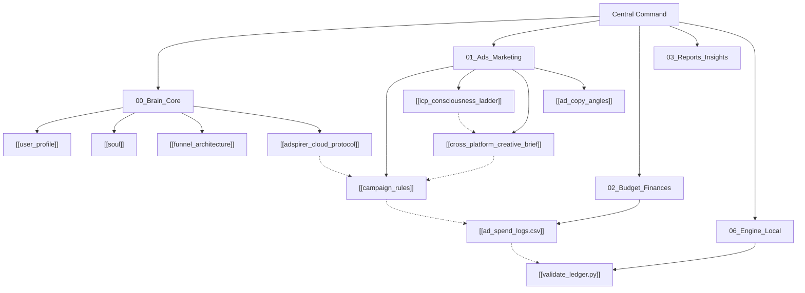

# 🧠 Doctors of Soul — Central Command & Neural Map

> **Welcome to the Doctors of Soul Second Brain.**  
> Decision Lead: [[user_profile|Prashant Jaiswal]]  
> Domain: [doctorsofsoul.co.in](https://doctorsofsoul.co.in)  
> Core Philosophy: [[soul|Advaita, Nervous System Regulation & Conscious Agency]]

---

## 🗺️ Map of Content (Interactive Neural Hub)

---

## 📂 Vault Department Access

### 1. [[00_Brain_Core]]
- [[user_profile]] — Executive identity, mission parameters, and philosophical charter.
- [[soul]] — Brand voice, tonal rules, and foundational book manifesto.
- [[funnel_architecture]] — The ₹9 Domestic / $9 Global Tripwire mechanics and backend value ascension.
- [[adspirer_cloud_protocol]] — **Rules of Engagement for Claude Code**: 15 Adspirer calls conservation, Meta + Google allocation, and the 10x Flywheel Scaling Gate.

### 2. [[01_Ads_Marketing]]
- [[cross_platform_creative_brief]] — Low-cost, high-impression creative blueprints for Meta (Instagram/FB) & Google Ads (Group A & Group B).
- [[icp_consciousness_ladder]] — The 4-Stage Consciousness Funnel (Astrology Seeker → Agency → Egoless Action → AI Financial Sovereignty).
- [[campaign_rules]] — Operational rules and "Audit Before Kill" logic. **Budget split is an open owner decision** (₹100/day total vs ₹400/day = 4 × ₹100); see [[2026-10-27_truth_pass]].
- [[ad_copy_angles]] — High-converting static image-text copy swipe files.
- [[campaign_v2_plan_2026-10-27]] — Prepared campaign v2: 2 brand-aligned creatives, corrected UTMs, paused-only launch. Zero spend.

### 3. [[02_Budget_Finances]]
- [[ad_spend_logs.csv]] — Clean daily ad spend ledger (ready for live Adspirer data ingest).

### 4. [[03_Reports_Insights]]
- [[2026-10-27_truth_pass]] — **Current verified status** (live prices, meeting fee, tracking, code/tests, open decisions).
- [[2026-10-26_decision_memo]] — **UNVERIFIED**: its ₹700 spend / 24 sales / CAC figures have no ledger behind them.

### 5. [[06_Engine_Local]]
- [[validate_ledger.py]] — Zero-dependency local Python analytics validator (Windows UTF-8 hardened).
