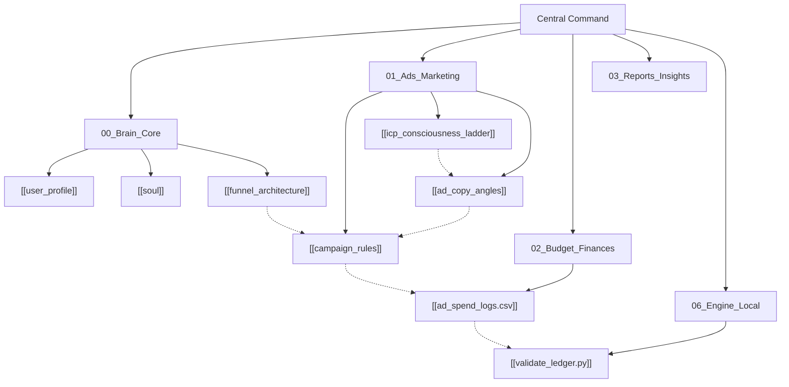

# 🧠 Doctors of Soul — Central Command & Neural Map

> **Welcome to the Doctors of Soul Second Brain.**  
> Decision Lead: [[user_profile|Prashant Jaiswal]]  
> Domain: [doctorsofsoul.co.in](https://doctorsofsoul.co.in)  
> Core Philosophy: [[soul|Advaita, Nervous System Regulation & Conscious Agency]]

---

## 🗺️ Map of Content (Interactive Neural Hub)

---

## 📂 Vault Department Access

### 1. [[00_Brain_Core]]
- [[user_profile]] — Executive identity, mission parameters, and philosophical charter.
- [[soul]] — Brand voice, tonal rules, and foundational book manifesto.
- [[funnel_architecture]] — The ₹9 Domestic / $9 Global Tripwire mechanics and backend value ascension.

### 2. [[01_Ads_Marketing]]
- [[icp_consciousness_ladder]] — The 4-Stage Consciousness Funnel (Astrology Seeker → Agency → Egoless Action → AI Financial Sovereignty).
- [[campaign_rules]] — The ₹100/day lean operational parameters, CAC boundaries, and "Audit Before Kill" logic.
- [[ad_copy_angles]] — High-converting static image-text copy swipe files.

### 3. [[02_Budget_Finances]]
- [[ad_spend_logs.csv]] — Daily ad spend ledger.

### 4. [[03_Reports_Insights]]
- Daily decision memos, creative post-mortems, and performance reviews.

### 5. [[06_Engine_Local]]
- [[validate_ledger.py]] — Zero-dependency local Python analytics validator.
