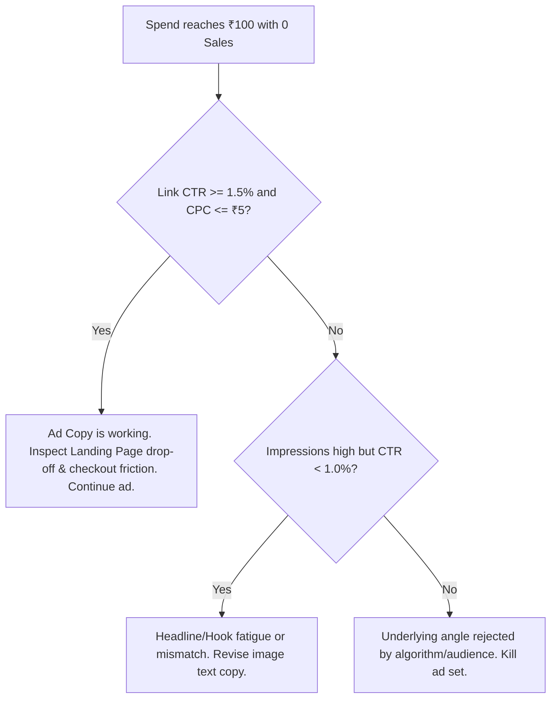

# Campaign Operational Rules & Decision Framework

**Status:** ACTIVE & RATIFIED (Post-Intake)  
**Budget Tier:** Lean Discovery Mode (₹100/day)  
**Core Conversion Asset:** Level 1 Tripwire Book (₹9 INR Domestic / $9 USD Global) → 1:1 Clarity Session Upsell  
**Parent Framework:** [[funnel_architecture]]  

---

## 1. Unit Economics & CAC Boundaries
- **Daily Testing Allocation:** ₹100 / day
- **Target CAC (Book Purchase / Session):** ₹10.00 – ₹30.00 INR
- **Hard CAC Ceiling:** ₹50.00 INR
- **Daily Target Volume:** 2 to 10 purchases/bookings per ₹100 spent.

---

## 2. Downside Protection: "Audit Before Kill" Protocol
When cumulative ad spend on a creative hits **₹100 with 0 sales/bookings**, **DO NOT blind-kill**. Execute the following diagnostic tree:

### Diagnostic Decision Metrics:
1. **Link Click-Through Rate (CTR):**
   - `< 1.0%`: Hook/headline failure. Revise image text overlay in [[ad_copy_angles]].
   - `> 1.8%`: Hook resonates; issue lies in landing page pitch or payment checkout flow.
2. **Cost Per Click (CPC):**
   - Benchmark Target: `<= ₹3.00 – ₹5.00 INR`.
   - Alert Threshold: `> ₹8.00 INR` indicates poor audience targeting alignment. Cross-check [[icp_consciousness_ladder]].
3. **Hard-Stop Spend:** If cumulative spend exceeds **₹200** with zero purchases after creative optimization, pause and pivot angle.

---

## 3. Creative Hierarchy & Format Protocol
- **Stage 1 (Current):** High-contrast **Static Image + Text Overlay** (Minimal asset overhead, maximum copy clarity). Swipe templates in [[ad_copy_angles]].
- **Stage 2 (Scale Gate):** Introduce **Short-Form Video Reels Hooks** only if static image CPMs spike or video CPC demonstrates lower CAC.

---

### Connected Second Brain Nodes:
- Central Command: [[HOME_DASHBOARD]]
- Ledger: [[ad_spend_logs.csv]]
- Engine Validator: [[validate_ledger.py]]
- Creative Angles: [[ad_copy_angles]]
- ICP Consciousness Ladder: [[icp_consciousness_ladder]]
