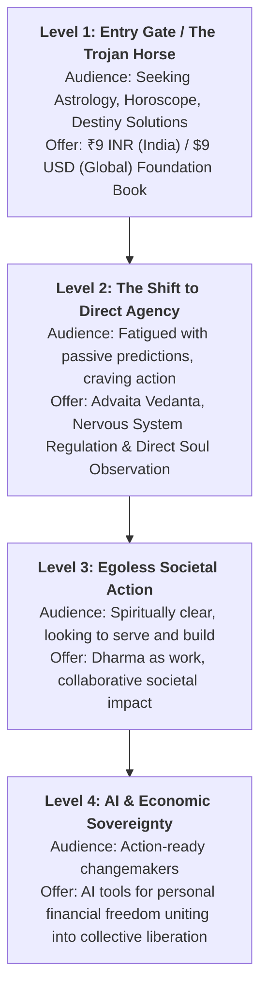

# ICP Consciousness-Ladder & Targeting Strategy

**Platform:** Doctors of Soul ([doctorsofsoul.co.in](https://doctorsofsoul.co.in))  
**Founder:** [[user_profile|Prashant Jaiswal]]  
**Core Soul Mission:** [[soul]]  

---

## 1. The 4-Stage Consciousness Ladder

---

## 2. Granular Tier Breakdown

### Level 1: The Seekers of Fate (Trojan Horse Entry)
- **Mindset:** "Why is this happening to me? What does my horoscope or planetary alignment say? When will my bad phase end?"
- **Pain Points:** Anxiety about career, marriage, finances, existential stuckness.
- **Strategic Vehicle:** The ₹9 entry book (₹9 in India / $9 internationally). Low financial barrier, high psychological accessibility.
- **The Core Bridge:** Meet them with respect for astrology, then gently introduce the boundary: *Astrology can indicate the weather, but you still have to build the boat.*
- **Actionable Copy:** See Angle 01 & 02 in [[ad_copy_angles]].

### Level 2: The Agency Seekers (Advaita & Direct Observation)
- **Mindset:** "I have studied astrology and read predictions, but nothing changes unless I change my thought patterns and nervous system."
- **Focus:** Transitioning from external superstition to Advaita Vedanta, direct observation of the ego, and conscious inner stillness.
- **Core Vehicle:** 1:1 Clarity Session + Full 4-Book Bundle. See [[soul]] and [[funnel_architecture]].

### Level 3: Egoless Action in Society (Karma Yoga in the Modern Era)
- **Mindset:** "Now that my mind is quiet, how do I act without ego in the workplace, family, and society?"
- **Focus:** True service (*Seva* and *Swadharma*) as a profession and social responsibility.

### Level 4: AI & Economic Sovereignty
- **Mindset:** "To truly help others and live freely, I must first achieve personal financial independence."
- **Focus:** Practical empowerment through AI workflows and modern leverage, leading from personal financial sovereignty into collective freedom.

---

## 3. Ideal Audience Targeting Overlays (Level 1 Ad Sets)
To ensure high conversion and low payment drop-off at ₹100/day (governed by [[campaign_rules]]):
- **Demographics:** Age 21–38 (India-wide metro and Tier-2 educational hubs).
- **Behavioral Filters:**
  1. **Digital Payers:** Engaged shoppers / UPI / Online payment active users.
  2. **Modern/AI Orientation:** Users interested in modern productivity, AI tools, or tech growth.
  3. **Esoteric Seeking:** Engaged with Astrology, Kundali, Numerology, or Mindfulness pages.

---

### Connected Second Brain Nodes:
- Central Command: [[HOME_DASHBOARD]]
- Campaign Rules: [[campaign_rules]]
- Ad Creatives: [[ad_copy_angles]]
- Funnel Blueprint: [[funnel_architecture]]
